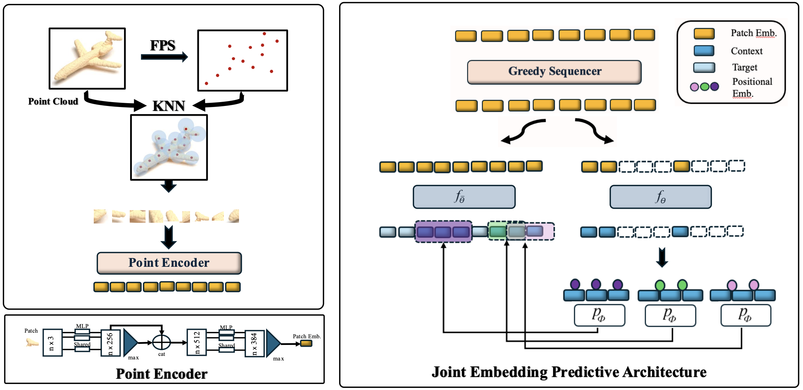

# Point-JEPA

[](https://paperswithcode.com/sota/3d-point-cloud-linear-classification-on?p=point-jepa-a-joint-embedding-predictive)
[](https://paperswithcode.com/sota/few-shot-3d-point-cloud-classification-on-3?p=point-jepa-a-joint-embedding-predictive)
[](https://paperswithcode.com/sota/few-shot-3d-point-cloud-classification-on-2?p=point-jepa-a-joint-embedding-predictive)

We propose a joint embedding predictive architecture (JEPA) for point cloud self-supervised learning.
Our method efficiently computes and utilizes the proximity of point cloud patch embeddings based on their indices during target and context selection.
The sequencer allows shared computations of the patch embeddings' proximity between context and target selection, further improving efficiency.
Please refer to the [paper](https://arxiv.org/abs/2404.16432) for more details.




## EN3160 university presentation and research reproduction

Our completed frozen-encoder research compares a Max + Mean + MLP control (92.02%) with Max + Attention + MLP (92.18%) and Max + Min + Population Std + MLP (90.28%). Population deviation uses `unbiased=False`. The separately reproduced linear SVM achieved 93.60% under a different training/feature protocol. See the [complete research README](experiments/pooling_comparison/README.md) for measured metrics, both extensions, provenance, limitations, and reproduction commands.

### Quick live demonstration

Run from this **Point-JEPA project root**, not the parent `github` Git root:

```bash
source /home/heshan-ranasinghe/miniforge3/etc/profile.d/conda.sh
conda activate pointjepa
python --version
python -B experiments/pooling_comparison/pooling_models.py
python -B -m scripts.pretrained_encoder_inference
```

The Conda shell-hook path is specific to our workstation. The pooling test uses synthetic inputs; encoder inference uses one real training object. The existing environment, pretrained checkpoint, and ModelNet40 training files must be available. Open the retained [comparison figure](experiments/pooling_comparison/figures/three_model_comparison/full_test_metric_comparison.png) and [protocol summary](experiments/pooling_comparison/figures/three_model_comparison/publication_summary.png) for the presentation.

### Complete experimental reproduction

The [research reproduction guide](experiments/pooling_comparison/README.md#complete-experimental-reproduction) documents feature extraction, separate SVM reproduction, neural training, and saved-run evaluation. Those expensive workflows are already completed and are unnecessary for the live demo. Integrity validation and figure regeneration use existing records:

```bash
python -B experiments/pooling_comparison/validate_migration.py
python -B experiments/pooling_comparison/plot_results.py --overwrite
```

`--overwrite` is required to regenerate the existing **new three-model** figure directory. Historical two-model figures and recorded results remain protected. The validator reads local cache/checkpoints and HDF5 labels; it does not train or run official test inference.

The sections below describe upstream Point-JEPA installation and paper workflows. They are separate from our completed pooling experiments.

## Installation

### 1. Dependencies

For a new installation only; do not rerun this installer in our already configured `pointjepa` environment. Run from the Point-JEPA project root. The command below removes legacy CRLF line endings before executing the upstream installer; it downloads/builds dependencies and may take substantial time.

- Python 3.10.4
- CUDA 11.6 or above
- cuDNN 8.4.0 or above
- GCC >= 6 and <= 11.2.1

```bash
sed 's/\r$//' install_py.sh | bash
```

### 2. Datasets

See [DATASETS.md](DATASETS.md) for download instructions.

### 3. Upstream dataset check and pretraining (optional)

The dataset checker requires **all** upstream datasets (including ScanObjectNN, ShapeNet55, ShapeNetPart, and few-shot assets), not just the locally installed ModelNet40. The `fit` command starts full ShapeNet pretraining and is expensive; neither command is a presentation smoke test. Both commands run from the Point-JEPA project root.

```bash
python -m pointjepa.datasets.process.check # check if datasets are complete
python -m pointjepa fit -c configs/Point-JEPA/pretraining/shapenet.yaml
```

## Model Zoo


| Type                         | Dataset      | Evaluation                          | Config                                                                                       | Checkpoint                                                                                                                                    |
| ---------------------------- | ------------ | ----------------------------------- | -------------------------------------------------------------------------------------------- | --------------------------------------------------------------------------------------------------------------------------------------------- |
| Point-JEPA pre-trained        | ShapeNet     | -                                   | [config](configs/Point-JEPA/pretraining/shapenet.yaml)                                                  | [checkpoint](https://drive.google.com/file/d/1MR3OYA6N0TINyPCKgwOU3zswQoM8DXbY/view?usp=drive_link)                          |
| Point-JEPA SVM Linear | ShapeNet     | **93.7&pm;0.2**                                   | -                                                  | [checkpoint](https://drive.google.com/file/d/1MR3OYA6N0TINyPCKgwOU3zswQoM8DXbY/view?usp=drive_link)                          |
| Classification fine-tuned    | ModelNet40   | **93.8&pm;0.2** / **94.1&pm;0.1** (OA / Voting) | [config](configs/Point-JEPA/classification/modelnet40.yaml)   | [checkpoint](https://drive.google.com/file/d/1EOiHBu06pRah2MRlEapPQmks3BmjXgbB/view?usp=sharing)         |
| Classification fine-tuned    | ScanObjectNN | **86.6&pm;0.3** (OA)                      | [config](configs/Point-JEPA/classification/scanobjectnn.yaml) | [checkpoint](https://drive.google.com/file/d/1vnhQdVBliGxQ09vazZCuOlFsgBAThlqg/view?usp=sharing)       |
| Part segmentation fine-tuned | ShapeNetPart | **85.8&pm;0.1** (Cat. mIoU)               | [config](configs/Point-JEPA/segmentation/shapenetpart.yaml)                                        | [checkpoint](https://drive.google.com/file/d/1lS1_lKTsaTgQ4MCucfSCkmNyhLAgaxG7/view?usp=sharing) |


Please note that weights that are attached above are the ones that yields the best results out of 10 independent runs (details mentioned in the paper).

## Reproducing the results from the paper

The scripts in this section use Weights & Biases for logging, so it's important to log in once with `wandb login` before running them.
Checkpoints will be saved to the `artifacts` directory.

**A note on reproducibility:**
While reproducing our results on most datasets is straightforward, achieving the same test accuracy on ModelNet40 is more complicated due to the high variance between runs (see also https://github.com/Pang-Yatian/Point-MAE/issues/5#issuecomment-1074886349, https://github.com/ma-xu/pointMLP-pytorch/issues/1#issuecomment-1062563404, https://github.com/CVMI-Lab/PAConv/issues/9#issuecomment-886612074).
To obtain comparable results on ModelNet40, you will likely need to experiment with a few different seeds (This is the motivation behind multiple runs in our paper).
However, if you would like to precisely replicate our test environment, you can try the following

We used a mixture of  two environments (compute canada and the other), [Narval](https://docs.alliancecan.ca/wiki/Narval/en) server and another. Narval server was used for pretrainng and the other server was used specifically for downstream tasks.

##### For pre-training (compute canada)
- Python 3.10.2
- CUDA 11.4
- on A100SXM4

##### For downstream tasks
- Python 3.10.2
- CUDA 11.8
- on RTX 5500

## Acknowledgements

This codebase is built upon [Point2Vec](https://github.com/kabouzeid/point2vec) and draws inspiration from [PointGPT](https://github.com/CVMI-Lab/PointGPT)'s efficient point ordering implementation. We thank the authors of both repositories for their contributions.

## Citation

You can cite our paper as follows:

```bibtex
@inproceedings{pointjepa2025,
    title={Point-JEPA: Joint Embedding Predictive Architecture for 3D Point Cloud Self-supervised Learning},
    author={Saito, Ayumu and Kudeshia, Prachi and Poovvancheri, Jiju},
    booktitle={IEEE/CVF Winter Conference on Applications of Computer Vision (WACV)},
    year={2025}
}
```
